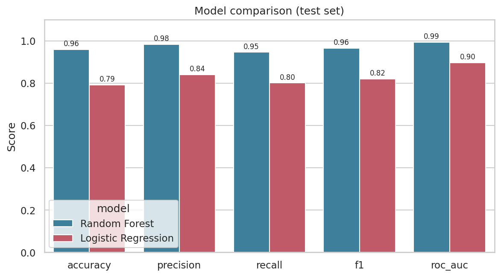
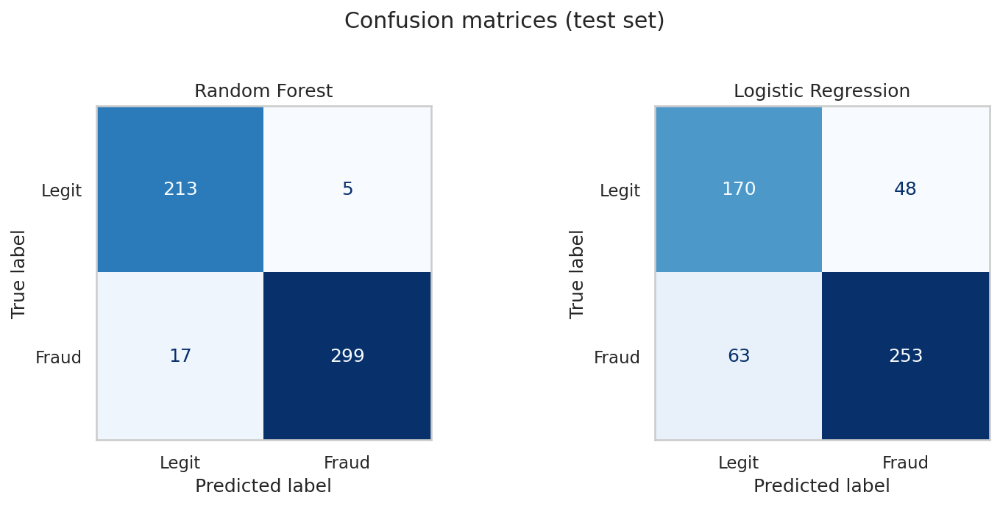
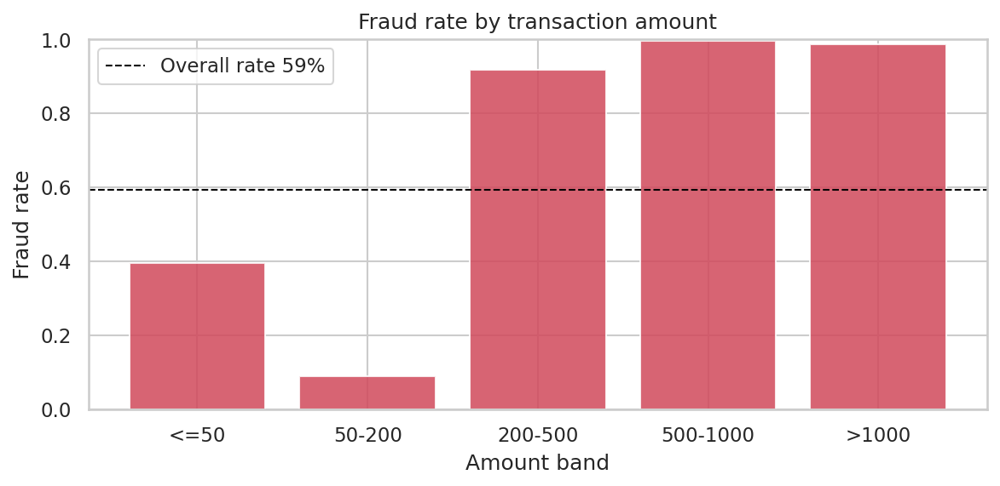
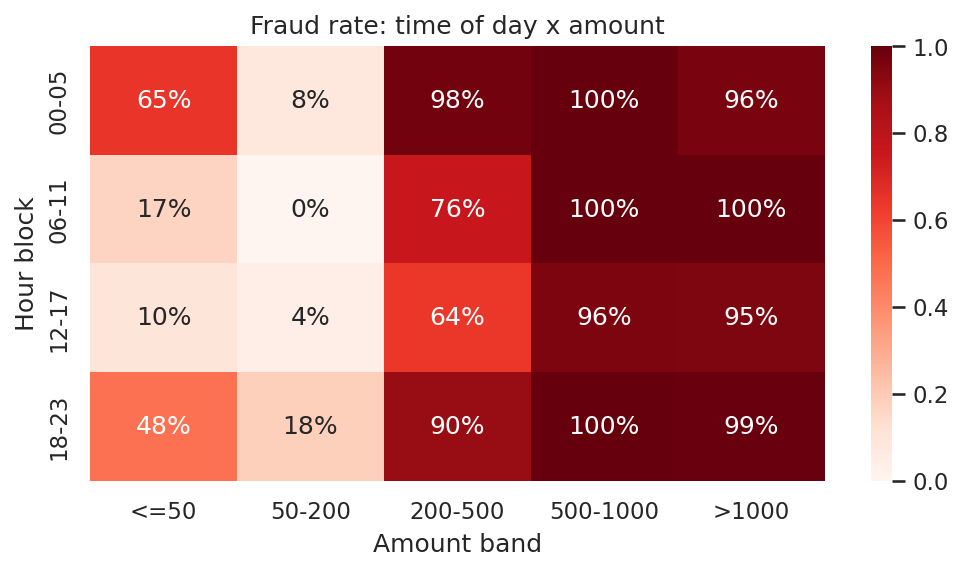
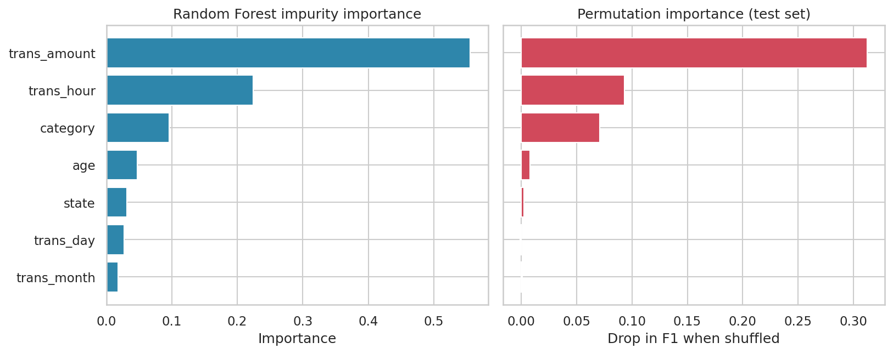
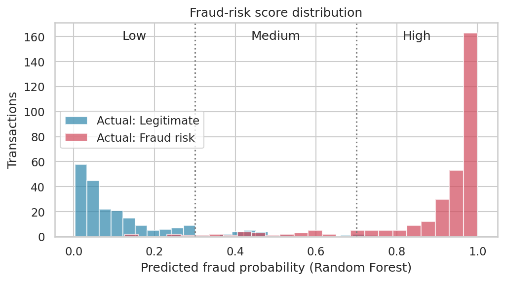

# 🛡️ UPI Fraud Detection & Risk Analysis

An end-to-end machine learning project that analyses UPI transactions, compares **Random Forest** against **Logistic Regression** for fraud detection, and scores new transactions through an interactive **Streamlit** app.


## Results

Evaluated on a stratified 20% held-out test set (534 transactions). Cross-validated F1 uses 5-fold CV on the training set.

| Model | Accuracy | Precision | Recall | F1 | ROC-AUC | CV F1 (5-fold) |
|---|---|---|---|---|---|---|
| **Random Forest** | **0.959** | **0.984** | **0.946** | **0.965** | **0.993** | 0.960 ± 0.006 |
| Logistic Regression | 0.792 | 0.841 | 0.801 | 0.820 | 0.897 | 0.828 ± 0.028 |




## Key findings

- **Transaction amount is the dominant signal.** Fraud rate is ~9% for amounts of 50–200, but roughly 92% or higher for anything over 200. Very small amounts (≤ 50) also show elevated risk (~39%).
- **Time of day is the second strongest signal.** Small transactions at night (00–05) are far riskier than the same amounts during the day.
- **Why Random Forest wins by ~15 F1 points:** the relationship between amount and fraud is *non-monotonic* (low → high → low → very high), which a linear model cannot represent. Trees split on it naturally.
- Age, state, day and month contribute little (see permutation importance below).






## Features

- Exploratory **transaction analysis** (amount, hour, category, age group, hour × amount heatmap)
- **Random Forest** and **Logistic Regression** trained as scikit-learn `Pipeline`s (preprocessing is saved with the model)
- **Precision / Recall / F1 / ROC-AUC**, confusion matrices, ROC curves, 5-fold cross-validation
- **Feature importance** — impurity-based and permutation-based
- **Fraud-risk visualisation** — probability distribution with Low / Medium / High bands
- **Streamlit app** with analysis, model comparison, and live prediction for a new transaction

## Project structure

```
upi-fraud-detection/
├── app.py                  # Streamlit interface
├── requirements.txt
├── data/
│   └── upi_fraud_dataset.csv
├── src/
│   ├── config.py           # paths, feature lists, risk bands
│   ├── data.py             # loading + stratified split
│   ├── models.py           # RF and LR pipelines
│   ├── train.py            # train, evaluate, save models + all figures
│   ├── predict.py          # score a single transaction
│   └── visualize.py        # every plot (shared by report and app)
├── models/                 # saved .joblib models
└── reports/
    ├── metrics.csv / metrics.json
    ├── feature_importance.csv
    └── figures/            # 13 generated charts
```

## Getting started

```bash
git clone https://github.com/<your-username>/upi-fraud-detection.git
cd upi-fraud-detection

python -m venv .venv
source .venv/bin/activate        # Windows: .venv\Scripts\activate
pip install -r requirements.txt

python -m src.train              # trains models, writes metrics + figures
streamlit run app.py             # launches the app
```

Score a transaction from Python:

```python
from src.predict import load_models, predict_transaction

txn = {"trans_hour": 2, "trans_day": 14, "trans_month": 6,
       "category": 4, "age": 35, "trans_amount": 850.0, "state": 22}
print(predict_transaction(load_models(), txn))
```

## Dataset

2,666 UPI transactions with 11 columns: hour/day/month/year, merchant `category` code, `upi_number`, customer `age`, `trans_amount`, `state` code, `zip`, and the label `fraud_risk` (1 = fraud risk, 0 = legitimate).

Preprocessing decisions:

| Column | Decision | Reason |
|---|---|---|
| `upi_number` | dropped | unique per row → an ID, not a feature |
| `zip` | dropped | no relationship with the label |
| `trans_year` | dropped | constant (2022) |
| `category`, `state` | one-hot for Logistic Regression | they are coded labels, not quantities |

## Methodology

1. Stratified 80/20 train/test split (`random_state=42`) to preserve the class ratio.
2. Both models are fit on the training set only; the test set is never used for tuning.
3. Metrics reported at a 0.5 probability threshold. Risk bands in the app: **Low** < 30%, **Medium** 30–70%, **High** > 70%.
4. Permutation importance is computed on the test set to avoid the bias of impurity-based importance towards high-cardinality features.

## Limitations

- The dataset is small (2,666 rows) and **59% of rows are labelled fraud**, far above real-world fraud rates (well under 1%). It is most likely synthetic or curated, so the scores above show the modelling approach works, not that this would perform at 96% in production.
- On real, heavily imbalanced data, accuracy would be misleading; precision-recall curves, class weighting, and threshold tuning would be the priority.
- `category` and `state` are anonymised codes, so results cannot be tied to specific merchants or regions.

## Future improvements

- Hyperparameter search (`GridSearchCV` / `RandomizedSearchCV`)
- Gradient boosting (XGBoost / LightGBM) comparison
- SHAP explanations for individual predictions
- Precision-recall curve and cost-based threshold selection
- Deploy on Streamlit Community Cloud

## Author

**Shaik Mahammad Afzal** — Computer Engineering student, VIT-AP University

## License

MIT — see [LICENSE](LICENSE).
